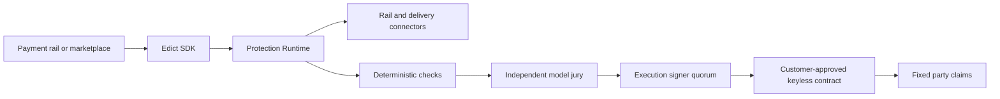

# Edict

[](https://github.com/m8ntat-syst8ms/Edict/actions/workflows/ci.yml)

**Edict Protect is autonomous, non-custodial dispute protection for agent
payments.** It commits transaction terms before funding, observes delivery and
evidence, resolves exceptions, and returns a verifiable result to a
customer-controlled settlement boundary.

> **Testnet preview:** the native NEAR deployment is unaudited and uses test
> value. Model seats and execution signers in the end-to-end testnet flow are
> test-only. Do not use this release with production funds.

## How It Works

1. **Protect** - the payment carries signed acceptance criteria, deadlines,
   permitted outcomes, and settlement policy.
2. **Observe** - connectors turn funding, delivery, acceptance, and challenges
   into a canonical event stream.
3. **Resolve** - deterministic checks run first. Ambiguous cases go to a
   multi-provider model jury with proof, consistency, and confidence gates.
4. **Settle** - independent execution signatures authorize only the committed
   outcome. A customer-approved contract revalidates the proof before updating
   fixed party claims.

Edict coordinates the decision path. It does not receive a customer private
key, control a payout address, or act as a required settlement signer.



## Integration

The customer platform already knows the parties, payment amount, promise, and
delivery context. Edict adds protection inside that existing flow:

```ts
import { createEdict } from '@edict/sdk';
import { ProtectionRuntimeHttpClient } from '@edict/protection-runtime';

const edict = createEdict({ mode: 'live', settlement });
const runtime = new ProtectionRuntimeHttpClient({ baseUrl, apiToken });
const payment = await edict.protectPayment(input);
await runtime.protect(payment, { profile: edict.profile, intents });
```

The default profile is wallet-native E0: no Edict account, KYB process, or
separate case form is required. Enterprise identity, customer policy packs,
human review, and additional legal assurance are explicit opt-in layers.

## Quick Start

Requirements: Node.js 22+, npm 10+, and stable Rust for contract tests.

```sh
npm ci
npm run check
npm run demo
```

Run the local customer sandbox:

```sh
node apps/protect/dist/cli.js --port 4880
```

Build the website:

```sh
npm run build -w @edict/site
```

Run the real-Wasm NEAR sandbox tests:

```sh
npm run test:sandbox
```

## Testnet Deployment

The current native NEAR deployment is live on NEAR Testnet:

- Factory: [`m2.edict-req-ggrb91.testnet`](https://testnet.nearblocks.io/address/m2.edict-req-ggrb91.testnet)
- Settlement: [`protect.m2.edict-req-ggrb91.testnet`](https://testnet.nearblocks.io/address/protect.m2.edict-req-ggrb91.testnet)

Both accounts have zero access keys. The deployment manifest, completed
accepted and disputed flows, limitations, and reproduction commands are in
[`TESTNET.md`](TESTNET.md).

NEAR Intents is the preferred cross-chain transport. Its settlement and
factory contracts pass a local sandbox against the pinned mainnet Verifier,
but Intents does not provide a testnet. An independent audit and capped
mainnet canary remain mandatory before cross-chain production use.

## Repository

| Path | Purpose |
|---|---|
| `packages/core` | Canonical case, mandate, policy, verdict, and connector types |
| `packages/evidence` | Canonical hashing, delivery manifests, evidence commitments, and machine checks |
| `packages/linter` | Deterministic pre-funding mandate analysis |
| `packages/sdk` | Customer integration surface and non-custodial settlement directives |
| `services/arbiter` | Deterministic checks, model jury orchestration, proof verification, and verdict aggregation |
| `services/protection-runtime` | Event ingestion, scheduling, encrypted evidence, adjudication, webhooks, and proof relays |
| `packages/near-intents` | Typed 1Click and signed-intent plans, including confidential-capability gates |
| `packages/near-deployer` | Keyless deployment plans and release-manifest verification |
| `contracts/near` | Native NEAR and NEAR Intents settlement and factory contracts |
| `apps/protect` | Customer activity and attention workspace, plus an explicit local sandbox |
| `apps/site` | Public Edict website |
| `apps/shadow-docket` | Reproducible adjudication harness with illustrative public fixtures |
| `apps/console` | Local policy and dispute-development console |
| `apps/mcp-server` | MCP tools for mandate drafting, linting, sandbox disputes, and case inspection |
| `infra/dstack-node` | Self-hosted attested inference-node package |
| `scripts/testnet` | Native NEAR testnet deployment and end-to-end product runner |

## Documentation

- [Product flow](docs/edict-protect.md)
- [Self-custody architecture](docs/self-custody-architecture.md)
- [Production readiness](docs/production-readiness.md)
- [Public/private repository boundary](docs/repository-boundary.md)
- [Contract architecture and tests](contracts/near/README.md)
- [Security policy](SECURITY.md)

## Release Status

`v0.1.0-testnet` is an engineering testnet release, not a mainnet or audited
release. The production blockers are independent contract and infrastructure
audits, production TEE signer operations, operational controls, and capped
mainnet canaries. Confidential Intents additionally requires stable
private-shard interfaces and independent verification.

## License

Copyright (c) 2026 Edict contributors. All rights reserved. See
[`LICENSE`](LICENSE).
