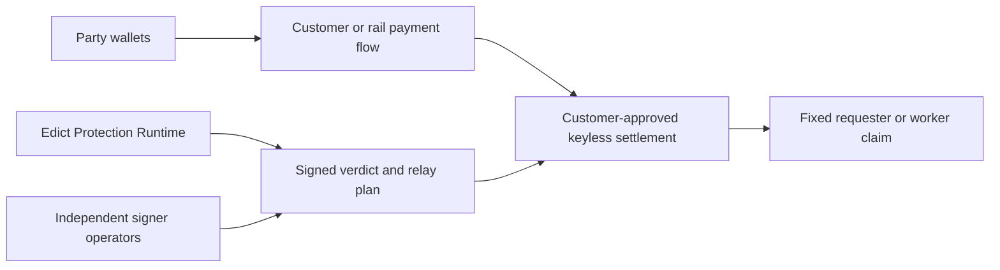

# Self-Custody Architecture

Edict is a decision and verification service. It is not a wallet, payment
processor, escrow operator, or custodian.

## Security Boundary

For a production-conforming integration:

- Edict receives no customer private key, MPC share, withdrawal credential,
  owner key, upgrade key, freeze right, or privileged payment token;
- Edict is not a required settlement signer;
- payout beneficiaries are fixed by the signed order before funding;
- settlement can select only an outcome in the signed Decision Space; and
- a customer or rail can replace the Edict runtime without changing custody.

These are architectural constraints, not policy promises.

## Topology

The Protection Runtime observes signed events, schedules deadlines, verifies
evidence, runs adjudication, collects independent execution signatures, and
prepares relay plans. A permissionless relayer may pay gas, but it cannot alter
the ruling or beneficiary.

The settlement contract independently verifies the order, case, round,
verdict hash, ruling, policy, challenge window, nonce, and signer quorum before
creating a claim.

## Customer-Approved Keyless Contracts

The default crypto deployment model is a content-addressed contract created at
the customer's direction and made keyless after initialization. This avoids
requiring each customer to operate a custom settlement service while keeping
Edict outside the control boundary.

A conforming instance has:

- no access keys after initialization;
- no owner, upgrade, pause, freeze, or arbitrary-withdraw method;
- immutable active-order rules and verifier policy;
- fixed party accounts and bounded payout branches;
- explicit liveness fallback after a signed timeout; and
- publicly verifiable code and configuration hashes.

The factory is administrative tooling only. It cannot change a child contract
after creation or substitute Edict governance for customer governance.

## Settlement Binding

Every protected order signs a `SettlementBinding` that records:

- custody mode (`M2_external_escrow` or `M4_no_custody`);
- funds controller;
- versioned adapter reference;
- resolution timeout and fallback;
- the fact that Edict cannot transfer or freeze funds and is not a required
  signer; and
- optional confidentiality capability, disclosure, and fallback commitments.

The Runtime rejects observed state that differs from those signed facts.

## NEAR Intents

NEAR Intents is the preferred cross-chain transport for supported assets and
networks. It does not replace the Edict settlement state machine.

The intended public flow is:

1. the requester authorizes an exact-output 1Click route;
2. the resulting asset reaches the requester's Intents balance;
3. an authenticated transfer binds the exact amount to the
   customer-approved settlement account;
4. the Edict contract applies the signed protection rules; and
5. final claims return to fixed party Intents accounts for party-authorized
   withdrawal.

The Edict Intents helpers produce plans and verify signed responses. They do
not accept a wallet client, private key, or spending callback.

## Confidential Intents

Private transport alone is not confidential settlement. The settlement state
machine must execute inside the verified private boundary, expose only the
committed disclosure surface, and fail closed when the signed capability is
unavailable.

The current release implements the signed privacy capability and release
gate. It does not include a live private-shard adapter.

## Runtime Data

The Runtime stores append-only events separately from evidence plaintext.
Evidence is encrypted at rest and referenced by content hash. Production
operators remain responsible for secure key management, access control,
retention, deletion, backup, and incident response.

Confidential evidence must not be submitted to a deployment whose signed
privacy capability does not cover storage, adjudication, and settlement.

## Customer and Rail Responsibilities

The customer or payment rail remains responsible for:

- wallet consent and transaction signing;
- deployment approval and artifact verification;
- finality and reorganization policy;
- gas sponsorship policy;
- withdrawal and beneficiary UX;
- monitoring and emergency procedures; and
- any legal, regulatory, safeguarding, sanctions, tax, or data-protection
  obligations applicable to its service.

## Efficacy Requirements

Self-custody must not weaken dispute protection. A production integration must
still provide:

- automatic funding, delivery, deadline, and challenge observation;
- objective-failure detection before model adjudication;
- authenticated evidence and replay protection;
- multiple independent model and infrastructure operators;
- challenge windows and explicit liveness fallbacks;
- local re-verification of every executable verdict; and
- permissionless proof and claim relay without beneficiary discretion.

The testnet release demonstrates these boundaries with test value and
test-only operators. Independent audit and production operations remain
required.
